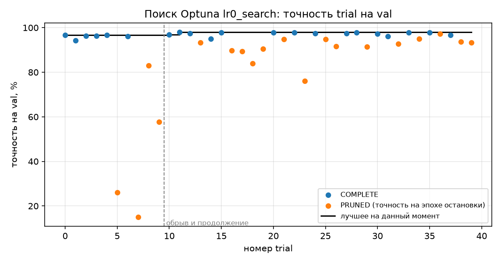
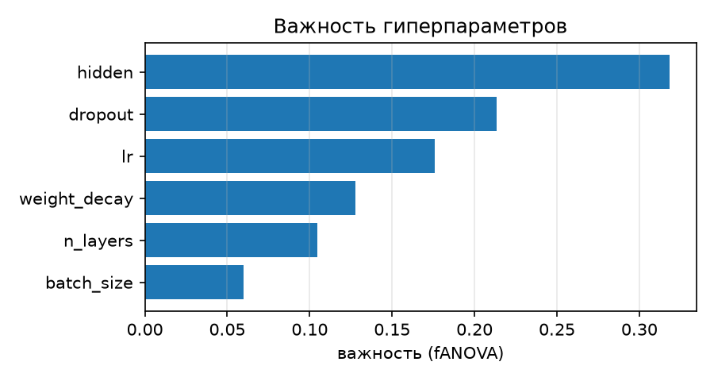
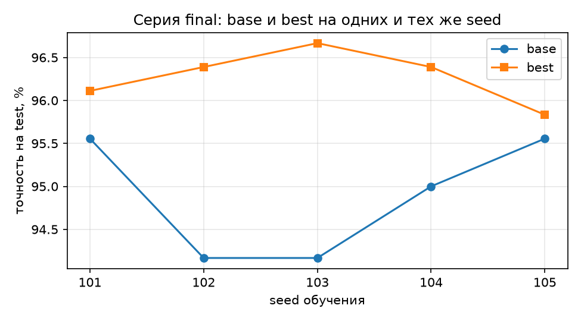

# Отчёт по ЛР0. Воспроизводимый эксперимент: подбор гиперпараметров нейросети

> Файл собран скриптом `make_report.py` из шаблона `report/REPORT_template.md`.
> Все числа подставлены из `runs/`, `optuna.db` и `mlflow.db`, вручную не переписывались.

## 1. Вопрос и прогноз

**Вопрос:** дал ли подбор гиперпараметров в Optuna улучшение, которое больше случайного разброса от seed?

Прогноз записан и закоммичен до итоговых запусков ([hypothesis.md](../hypothesis.md)). Кратко: разброс по seed меньше 1 п.п.;
лучший trial превзойдёт базовую конфигурацию на val на 1,5–2,5 п.п.; на новых seed и на test улучшение
уменьшится до 0,5–1,5 п.п.; большинство, но не обязательно все Δ на test будут положительными.
Сверка с результатом — в разделе 5.

## 2. Что сделано

```
configs/*.yaml ─┐                         ┌─> runs/<run_id>/ config.yaml, metadata.json,
data/split.json ┼─> train.py (1 запуск) ──┤      history.csv, predictions.csv, metrics.json
git (чистое     │      ▲                  └─> mlflow.db: параметры, метрики по эпохам, артефакты, теги
 дерево, коммит)┘      │
           run_series.py (серия = отдельные процессы)   search.py (Optuna, optuna.db) ─> те же Trainer.epochs()
```

- Данные: `load_digits` (scikit-learn 1.9.1), 1797 изображений 8×8. Стратифицированное разбиение с `split_seed = 0`:
  train / val / test = 1077 / 360 / 360. Индексы лежат в `data/split.json`, их SHA-256 записан в `data/manifest.json`
  и сверяется при каждой загрузке. Признаки делятся на 16.
- Модель: MLP 64 → n_layers × (Linear, ReLU, Dropout) → 10, Adam, кросс-энтропия, 30 эпох, CPU в 1 поток.
- Повторяемость: seed для `random`, NumPy и PyTorch, генератор DataLoader с тем же seed, `num_workers = 0`,
  `torch.use_deterministic_algorithms(True)`, `torch.set_num_threads(1)`.
- Итоговые запуски стартуют только при пустом `git status --porcelain`, в `metadata.json` пишется полный хеш коммита.
  `metrics.json` пересчитывается из `predictions.csv` и `history.csv`.
- Время обучения — сумма `epoch_time`. Это проход по train плюс оценка на val в каждой эпохе
  (`time.perf_counter`); загрузка данных и запись файлов в интервал не входят.
- Проверки реализации (`pytest`, 8 тестов) проходят: accuracy([1,2,3,3], [1,2,3,4]) = 0,75; точность из
  `predictions.csv` совпадает с посчитанной при обучении; seed 0 дважды даёт одинаковые файлы, seed 1 — другие;
  грязное дерево блокирует итоговый запуск; `lr: -1` отклоняется до обучения.

Всего итоговых запусков в `runs/`: 17; записей в эксперименте MLflow `lr0`: 59
(запуски, 40 trial и родительская запись поиска).

## 3. Результаты

### 3.1. Эксперимент 1. Повторяемость и разброс

**Повтор с seed 0** (серия `repeat_seed0`, `20261101-180940-repeat_seed0-s0-580bad`, `20261101-180952-repeat_seed0-s0-d0d7de`): `history.csv` без столбца времени совпадает — True;
`predictions.csv` совпадает — True; точность на val 95.00% в обоих запусках.
Столбец `epoch_time` побайтно не совпадает (False), так и должно быть: это замер времени, а не результат вычислений.

**Серия `base_seeds`** — базовая конфигурация, seed 1–5, val (знаменатель 360, запусков 5 из 5):

| seed | run_id | статус | val_acc, % | верно из 360 | время обучения, с |
|---|---|---|---|---|---|
| 1 | `20261101-181003-base_seeds-s1-786527` | completed | 96.11 | 346 | 0.48 |
| 2 | `20261101-181014-base_seeds-s2-7345ac` | completed | 95.83 | 345 | 0.48 |
| 3 | `20261101-181024-base_seeds-s3-0d4b8a` | completed | 95.56 | 344 | 0.49 |
| 4 | `20261101-181035-base_seeds-s4-43ced0` | completed | 95.56 | 344 | 0.48 |
| 5 | `20261101-181046-base_seeds-s5-f450d4` | completed | 95.83 | 345 | 0.49 |

Сводка: min 95.56%, медиана 95.83%, max 96.11%. **Разброс 0.56 п.п. = 2 изображения.**
Время обучения: медиана 0.48 с (0.48–0.49 с).

**Разные ли ошибки?** Seed 1 против seed 2: только первый верно классифицировал 0 изображений,
только второй — 1; оба ошиблись на 14. Ошибки базовой сети почти целиком одни и те же:
это «трудные» изображения, а seed влияет на 1–2 пограничных случая.

### 3.2. Эксперимент 2. Поиск гиперпараметров

Study `lr0_search` (`sqlite:///optuna.db`), TPESampler(seed=42), MedianPruner(n_startup_trials=5, n_warmup_steps=5),
seed обучения 0, 30 эпох. Поиск запущен командой `search.py --target 10`, остановлен после 10 trial и продолжен
командой `search.py --target 40` с `load_if_exists=True`: нумерация продолжилась с trial 10, а в MLflow все trial
лежат под одной родительской записью. Остановка была плановой (по числу trial), а не аварийной.

- Trial всего: 40; по состояниям: COMPLETE — 21, PRUNED — 19 (FAIL — 0).
- Выполнено эпох: 737 из 1200 — прунер сэкономил 38.6% эпох.
  Остановленные trial прерывались на эпохах 5–13.
- Время обучения в поиске: 86.6 с. Оценка сэкономленного времени: 46.8 с
  (35.1% от времени без прунера); для каждого PRUNED trial взято среднее время его эпохи × недоделанные эпохи.
- Лучший trial — **#11, val 98.06%**: lr = 0.00289, n_layers = 3, hidden = 289, dropout = 0.0977, weight_decay = 1.05e-06, batch_size = 128.
- Важность параметров (fANOVA, seed 0): hidden — 0.32, dropout — 0.21, lr — 0.18, weight_decay — 0.13, n_layers — 0.10, batch_size — 0.06.





Полная таблица trial — `report/exp2_trials.csv`.

### 3.3. Эксперимент 3. Честное сравнение

Серия `final` (10 запусков): `configs/base.yaml` и `configs/best.yaml` (параметры trial #11),
каждая с seed 101–105. Эти seed в поиске не использовались. Оценка на test (360 изображений) сделана один раз, только в этой серии.
Δ = acc(best) − acc(base) на одном и том же seed.

| seed | base val, % | best val, % | Δ val, п.п. | base test, % | best test, % | Δ test, п.п. | test: исправлено / испорчено |
|---|---|---|---|---|---|---|---|
| 101 | 95.56 | 97.22 | +1.67 | 95.56 | 96.11 | +0.56 | 6 / 4 |
| 102 | 95.00 | 98.33 | +3.33 | 94.17 | 96.39 | +2.22 | 13 / 5 |
| 103 | 95.56 | 98.06 | +2.50 | 94.17 | 96.67 | +2.50 | 12 / 3 |
| 104 | 95.00 | 96.94 | +1.94 | 95.00 | 96.39 | +1.39 | 8 / 3 |
| 105 | 95.28 | 98.06 | +2.78 | 95.56 | 95.83 | +0.28 | 8 / 7 |

- Δ на val: медиана +2.50 п.п., диапазон +1.67 … +3.33.
- **Δ на test: медиана +1.39 п.п., среднее +1.39 п.п., диапазон +0.28 … +2.50.**
- Суммарно по пяти seed best на test **исправила 47 и испортила 22** изображений (из 1800).



**Куда делась часть улучшения** — три числа для лучшей конфигурации:

| | точность |
|---|---|
| лучший trial в поиске (val, seed 0) | 98.06% |
| best на новых seed, среднее (val) | 97.72% |
| best на новых seed, среднее (test) | 96.28% |

От поиска к новым seed на val потеряно 0.33 п.п. Это смещение отбора: из 40 trial выбран тот,
которому на seed 0 и этих 360 изображениях повезло больше других. От val к test потеряно ещё 1.44 п.п.:
конфигурация выбиралась по val, и часть её преимущества — подгонка к val. Base на тех же seed: val 95.28%,
test 94.89%; у неё test тоже ниже val, то есть test в этом разбиении просто немного труднее.

## 4. Разбор примеров

- Seed 105: best исправила 8 изображений test и испортила 7, итог +1 изображение
  (+0.28 п.п.). Почти нулевой выигрыш получился из многих изменившихся ответов в обе стороны.
  Без подсчёта «исправлено / испорчено» этого не видно.
- Seed 103: исправлено 12, испорчено 3 — здесь выигрыш чёткий (+2.50 п.п.).
- Худшие остановленные trial поиска: trial 7: 15.0% на эпохе 5, lr = 0.000184, dropout = 0.16; trial 5: 26.1% на эпохе 5, lr = 0.000232, dropout = 0.45. У обоих `lr` у нижней границы пространства поиска:
  за 5 эпох прогрева прунера сеть почти не обучилась, точность намного ниже медианы прошлых trial, и прунер остановил
  их на первой же разрешённой эпохе. Дообучать такие trial до 30 эпох было бы пустой тратой времени.

## 5. Выводы и их границы

Сверка с прогнозом:

| Прогноз | Результат | |
|---|---|---|
| seed 0 дважды → одинаковые файлы | совпали (кроме времени эпохи) | подтвердился |
| разброс по seed < 1 п.п., точность 95–96% | 0.56 п.п., 95.56–96.11% | подтвердился |
| разные seed ошибаются на разных изображениях | различие лишь в 1 + 0, общие 14 | **не подтвердился** |
| лучший trial лучше base на val на 1,5–2,5 п.п. | 98.06% против медианы base 95.83% | подтвердился (на верхней границе) |
| самые важные — lr и hidden | первый — hidden, lr на 3-м месте | частично |
| прунер остановит ≈ половину, сэкономит 30–50% эпох | 19 из 40, 38.6% | подтвердился |
| на новых seed val ниже лучшего trial | ниже на 0.33 п.п. | подтвердился |
| на test выигрыш 0,5–1,5 п.п. | медиана +1.39 п.п. | подтвердился |
| большинство Δ на test > 0, но не обязательно все | положительны 5 из 5 | подтвердился |

**Ответ на главный вопрос.** Подбор дал улучшение, но не равномерно. Все 5 из 5 разностей на test
положительны, медиана +1.39 п.п. (около 5 изображений) — больше разброса по seed (0.56 п.п.),
а суммарно исправлено 47 изображений против 22 испорченных. Однако строго больше разброса только
3 из 5 разностей: при seed 105 выигрыш 1 изображение, при seed 101 — +0.56 п.п.,
ровно на уровне разброса. По критерию методички
(«все пять разностей положительны и больше разброса») улучшение **не вполне устойчиво**: в среднем best лучше, но для
отдельного seed выигрыш может оказаться в пределах шума. Лучший trial в поиске (98.06%) завышает реальный
результат: честная оценка — 96.28% на test против 94.89% у base.

**Границы выводов.** Выводы относятся к `load_digits` с данным разбиением (`split_seed = 0`), этому пространству поиска,
40 trial TPE с seed 42, CPU в один поток, PyTorch 2.15 / Optuna 5.0. Разброс измерен по пяти seed только для base;
разброс best может быть другим. 360 изображений — малая выборка: одно изображение = 0,28 п.п.
После оценки на test в систему ничего не менялось.

## 6. Кодогенерация

Код каркаса, проверки и скрипт отчёта написаны с помощью ИИ-ассистента (Claude) и проверены так:
- тестами `pytest` (раздел 2), в том числе на известном примере accuracy = 0,75;
- пересчётом: `metrics.json` строится из `predictions.csv`, тест сверяет его с точностью, посчитанной во время обучения;
- хеш `split.json` считается по тем же байтам, из которых читается разбиение (защита от «хешируем один файл, читаем другой»);
- знаменатель — все записи части (360); упавших запусков и FAIL trial нет, но они попали бы в таблицы со статусом;
- test читается только в серии `final` (флаг `--eval-test`), в поиске используется только val;
- таймер: `perf_counter` вокруг эпохи, запись файлов вне интервала;
- результаты (95–96% у base, разброс < 1 п.п., прунер ≈ половина trial) сверены с ориентирами методички.

## Артефакты

`runs/`, `optuna.db`, `mlflow.db` и `mlruns/` не хранятся в git и сдаются архивом `lr0_artifacts.zip`.
Выгрузка `mlflow.search_runs()` — `report/mlflow_runs.csv`. Пересчитать таблицы и отчёт: `python make_report.py`.
