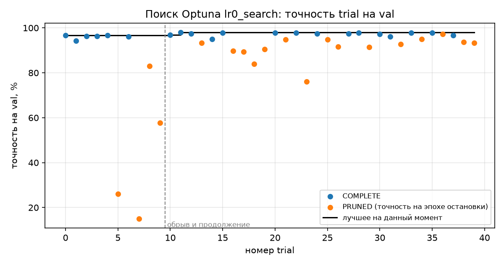
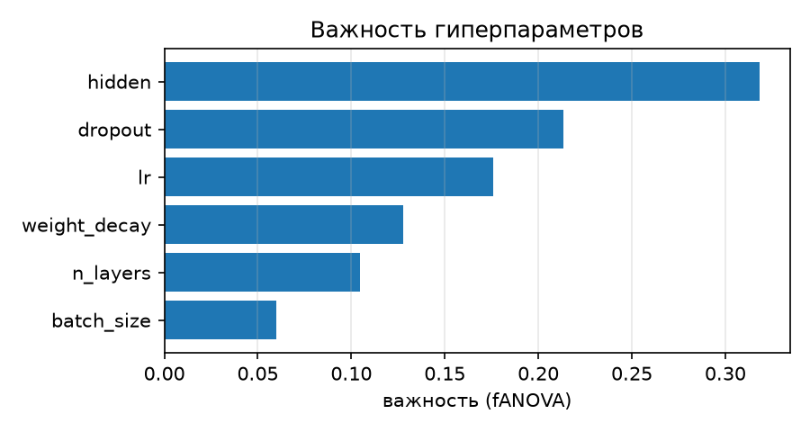
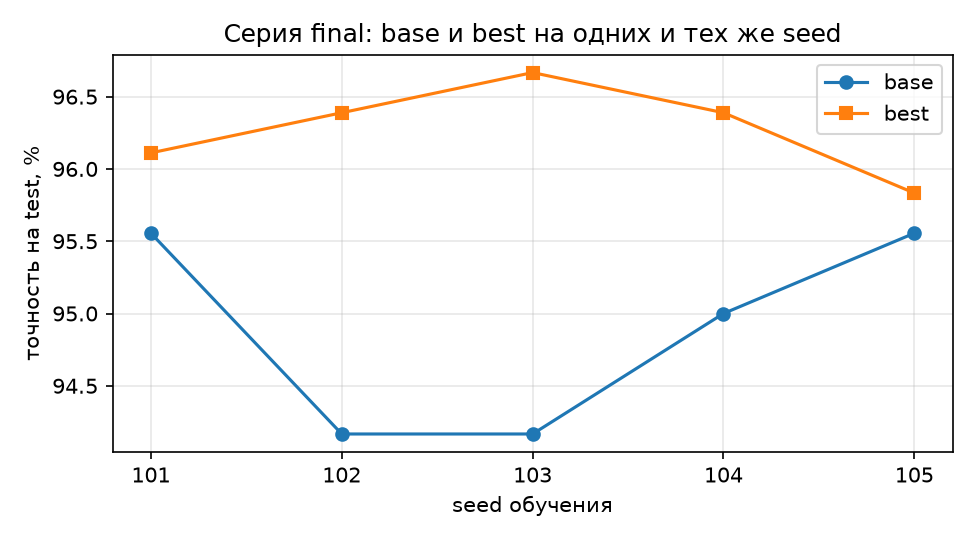

# Отчёт по ЛР0. Воспроизводимый эксперимент: подбор гиперпараметров нейросети

> Файл собран скриптом `make_report.py` из шаблона `report/REPORT_template.md`.
> Все числа подставлены из `runs/`, `optuna.db` и `mlflow.db`, вручную не переписывались.

## 1. Вопрос и прогноз

**Вопрос:** дал ли подбор гиперпараметров в Optuna улучшение, которое больше случайного разброса от seed?

Прогноз записан и закоммичен до итоговых запусков ([hypothesis.md](../hypothesis.md)). Кратко: разброс по seed меньше 1 п.п.;
лучший trial превзойдёт базовую конфигурацию на val на 1,5–2,5 п.п.; на новых seed и на test улучшение
уменьшится до 0,5–1,5 п.п.; большинство, но не обязательно все Δ на test будут положительными.
Сверка с результатом — в разделе 5.

## 2. Что сделано

```
configs/*.yaml ─┐                         ┌─> runs/<run_id>/ config.yaml, metadata.json,
data/split.json ┼─> train.py (1 запуск) ──┤      history.csv, predictions.csv, metrics.json
git (чистое     │      ▲                  └─> mlflow.db: параметры, метрики по эпохам, артефакты, теги
 дерево, коммит)┘      │
           run_series.py (серия = отдельные процессы)   search.py (Optuna, optuna.db) ─> те же Trainer.epochs()
```

- Данные: `load_digits` (scikit-learn 1.9.1), 1797 изображений 8×8. Стратифицированное разбиение с `split_seed = 0`:
  train / val / test = 1077 / 360 / 360. Индексы лежат в `data/split.json`, их SHA-256 записан в `data/manifest.json`
  и сверяется при каждой загрузке. Признаки делятся на 16.
- Модель: MLP 64 → n_layers × (Linear, ReLU, Dropout) → 10, Adam, кросс-энтропия, 30 эпох, CPU в 1 поток.
- Повторяемость: seed для `random`, NumPy и PyTorch, генератор DataLoader с тем же seed, `num_workers = 0`,
  `torch.use_deterministic_algorithms(True)`, `torch.set_num_threads(1)`.
- Итоговые запуски стартуют только при пустом `git status --porcelain`, в `metadata.json` пишется полный хеш коммита.
  `metrics.json` пересчитывается из `predictions.csv` и `history.csv`.
- Время обучения — сумма `epoch_time`. Это проход по train плюс оценка на val в каждой эпохе
  (`time.perf_counter`); загрузка данных и запись файлов в интервал не входят.
- Проверки реализации (`pytest`, 8 тестов) проходят: accuracy([1,2,3,3], [1,2,3,4]) = 0,75; точность из
  `predictions.csv` совпадает с посчитанной при обучении; seed 0 дважды даёт одинаковые файлы, seed 1 — другие;
  грязное дерево блокирует итоговый запуск; `lr: -1` отклоняется до обучения.

Всего итоговых запусков в `runs/`: ${n_runs_dirs}; записей в эксперименте MLflow `lr0`: ${mlflow_n_runs}
(запуски, 40 trial и родительская запись поиска).

## 3. Результаты

### 3.1. Эксперимент 1. Повторяемость и разброс

**Повтор с seed 0** (серия `repeat_seed0`, ${repeat_run_ids}): `history.csv` без столбца времени совпадает — ${repeat_history_equal};
`predictions.csv` совпадает — ${repeat_predictions_equal}; точность на val ${repeat_val_acc}% в обоих запусках.
Столбец `epoch_time` побайтно не совпадает (${repeat_epoch_time_equal}), так и должно быть: это замер времени, а не результат вычислений.

**Серия `base_seeds`** — базовая конфигурация, seed 1–5, val (знаменатель 360, запусков ${exp1_completed} из ${exp1_planned}):

${exp1_table}

Сводка: min ${exp1_min}%, медиана ${exp1_median}%, max ${exp1_max}%. **Разброс ${exp1_range_pp} п.п. = ${exp1_range_imgs} изображения.**
Время обучения: медиана ${exp1_time_median} с (${exp1_time_min}–${exp1_time_max} с).

**Разные ли ошибки?** Seed ${exp1_cmp_a} против seed ${exp1_cmp_b}: только первый верно классифицировал ${exp1_b_only} изображений,
только второй — ${exp1_a_only}; оба ошиблись на ${exp1_both_wrong}. Ошибки базовой сети почти целиком одни и те же:
это «трудные» изображения, а seed влияет на 1–2 пограничных случая.

### 3.2. Эксперимент 2. Поиск гиперпараметров

Study `lr0_search` (`sqlite:///optuna.db`), TPESampler(seed=42), MedianPruner(n_startup_trials=5, n_warmup_steps=5),
seed обучения 0, 30 эпох. Поиск запущен командой `search.py --target 10`, остановлен после 10 trial и продолжен
командой `search.py --target 40` с `load_if_exists=True`: нумерация продолжилась с trial 10, а в MLflow все trial
лежат под одной родительской записью. Остановка была плановой (по числу trial), а не аварийной.

- Trial всего: ${exp2_n_trials}; по состояниям: ${exp2_states} (FAIL — ${exp2_fail}).
- Выполнено эпох: ${exp2_epochs_done} из ${exp2_epochs_planned} — прунер сэкономил ${exp2_epochs_saved_pct}% эпох.
  Остановленные trial прерывались на эпохах ${exp2_pruned_epochs}.
- Время обучения в поиске: ${exp2_time_spent} с. Оценка сэкономленного времени: ${exp2_time_saved} с
  (${exp2_time_saved_pct}% от времени без прунера); для каждого PRUNED trial взято среднее время его эпохи × недоделанные эпохи.
- Лучший trial — **#${exp2_best_number}, val ${exp2_best_val}%**: ${exp2_best_params}.
- Важность параметров (fANOVA, seed 0): ${exp2_importance}.





Полная таблица trial — `report/exp2_trials.csv`.

### 3.3. Эксперимент 3. Честное сравнение

Серия `final` (${exp3_n_runs} запусков): `configs/base.yaml` и `configs/best.yaml` (параметры trial #${exp2_best_number}),
каждая с seed ${exp3_seeds}. Эти seed в поиске не использовались. Оценка на test (360 изображений) сделана один раз, только в этой серии.
Δ = acc(best) − acc(base) на одном и том же seed.

${exp3_table}

- Δ на val: медиана ${exp3_dval_median} п.п., диапазон ${exp3_dval_range}.
- **Δ на test: медиана ${exp3_dtest_median} п.п., среднее ${exp3_dtest_mean} п.п., диапазон ${exp3_dtest_range}.**
- Суммарно по пяти seed best на test **исправила ${exp3_fixed} и испортила ${exp3_broken}** изображений (из ${exp3_n_test_total}).



**Куда делась часть улучшения** — три числа для лучшей конфигурации:

| | точность |
|---|---|
| лучший trial в поиске (val, seed 0) | ${exp3_search_best}% |
| best на новых seed, среднее (val) | ${exp3_best_val_mean}% |
| best на новых seed, среднее (test) | ${exp3_best_test_mean}% |

От поиска к новым seed на val потеряно ${exp3_gap_search_val} п.п. Это смещение отбора: из 40 trial выбран тот,
которому на seed 0 и этих 360 изображениях повезло больше других. От val к test потеряно ещё ${exp3_gap_val_test} п.п.:
конфигурация выбиралась по val, и часть её преимущества — подгонка к val. Base на тех же seed: val ${exp3_base_val_mean}%,
test ${exp3_base_test_mean}%; у неё test тоже ниже val, то есть test в этом разбиении просто немного труднее.

## 4. Разбор примеров

- Seed 105: best исправила ${s105_fixed} изображений test и испортила ${s105_broken}, итог +${s105_dtest_imgs} изображение
  (${s105_dtest} п.п.). Почти нулевой выигрыш получился из многих изменившихся ответов в обе стороны.
  Без подсчёта «исправлено / испорчено» этого не видно.
- Seed 103: исправлено ${s103_fixed}, испорчено ${s103_broken} — здесь выигрыш чёткий (${s103_dtest} п.п.).
- Худшие остановленные trial поиска: ${exp2_worst_pruned}. У обоих `lr` у нижней границы пространства поиска:
  за 5 эпох прогрева прунера сеть почти не обучилась, точность намного ниже медианы прошлых trial, и прунер остановил
  их на первой же разрешённой эпохе. Дообучать такие trial до 30 эпох было бы пустой тратой времени.

## 5. Выводы и их границы

Сверка с прогнозом:

| Прогноз | Результат | |
|---|---|---|
| seed 0 дважды → одинаковые файлы | совпали (кроме времени эпохи) | подтвердился |
| разброс по seed < 1 п.п., точность 95–96% | ${exp1_range_pp} п.п., ${exp1_min}–${exp1_max}% | подтвердился |
| разные seed ошибаются на разных изображениях | различие лишь в ${exp1_a_only} + ${exp1_b_only}, общие ${exp1_both_wrong} | **не подтвердился** |
| лучший trial лучше base на val на 1,5–2,5 п.п. | ${exp2_best_val}% против медианы base ${exp1_median}% | подтвердился (на верхней границе) |
| самые важные — lr и hidden | первый — ${exp2_top_param}, lr на 3-м месте | частично |
| прунер остановит ≈ половину, сэкономит 30–50% эпох | ${exp2_pruned} из ${exp2_n_trials}, ${exp2_epochs_saved_pct}% | подтвердился |
| на новых seed val ниже лучшего trial | ниже на ${exp3_gap_search_val} п.п. | подтвердился |
| на test выигрыш 0,5–1,5 п.п. | медиана ${exp3_dtest_median} п.п. | подтвердился |
| большинство Δ на test > 0, но не обязательно все | положительны ${exp3_dtest_positive} из 5 | подтвердился |

**Ответ на главный вопрос.** Подбор дал улучшение, но не равномерно. Все ${exp3_dtest_positive} из 5 разностей на test
положительны, медиана ${exp3_dtest_median} п.п. (около ${exp3_dtest_median_imgs} изображений) — больше разброса по seed (${exp1_range_pp} п.п.),
а суммарно исправлено ${exp3_fixed} изображений против ${exp3_broken} испорченных. Однако строго больше разброса только
${exp3_dtest_above_spread} из 5 разностей: при seed 105 выигрыш ${s105_dtest_imgs} изображение, при seed 101 — ${s101_dtest} п.п.,
ровно на уровне разброса. По критерию методички
(«все пять разностей положительны и больше разброса») улучшение **не вполне устойчиво**: в среднем best лучше, но для
отдельного seed выигрыш может оказаться в пределах шума. Лучший trial в поиске (${exp3_search_best}%) завышает реальный
результат: честная оценка — ${exp3_best_test_mean}% на test против ${exp3_base_test_mean}% у base.

**Границы выводов.** Выводы относятся к `load_digits` с данным разбиением (`split_seed = 0`), этому пространству поиска,
40 trial TPE с seed 42, CPU в один поток, PyTorch 2.15 / Optuna 5.0. Разброс измерен по пяти seed только для base;
разброс best может быть другим. 360 изображений — малая выборка: одно изображение = 0,28 п.п.
После оценки на test в систему ничего не менялось.

## 6. Кодогенерация

Код каркаса, проверки и скрипт отчёта написаны с помощью ИИ-ассистента (Claude) и проверены так:
- тестами `pytest` (раздел 2), в том числе на известном примере accuracy = 0,75;
- пересчётом: `metrics.json` строится из `predictions.csv`, тест сверяет его с точностью, посчитанной во время обучения;
- хеш `split.json` считается по тем же байтам, из которых читается разбиение (защита от «хешируем один файл, читаем другой»);
- знаменатель — все записи части (360); упавших запусков и FAIL trial нет, но они попали бы в таблицы со статусом;
- test читается только в серии `final` (флаг `--eval-test`), в поиске используется только val;
- таймер: `perf_counter` вокруг эпохи, запись файлов вне интервала;
- результаты (95–96% у base, разброс < 1 п.п., прунер ≈ половина trial) сверены с ориентирами методички.

## Артефакты

`runs/`, `optuna.db`, `mlflow.db` и `mlruns/` не хранятся в git и сдаются архивом `lr0_artifacts.zip`.
Выгрузка `mlflow.search_runs()` — `report/mlflow_runs.csv`. Пересчитать таблицы и отчёт: `python make_report.py`.
